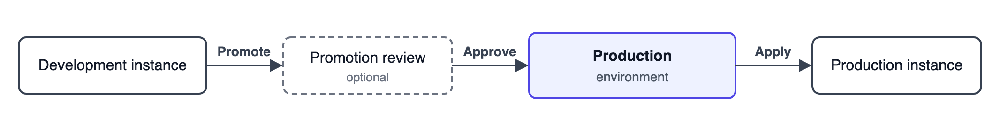

# Environments

Environments let you move workflows and other n8n resources, such as credentials, variables, and data tables, through the steps of your release process, such as development, staging, and production. You build and test changes on one instance, then promote them to the next step.


**Feature availability**

Environments are available on:

- **n8n Cloud:** Business, Enterprise
- **Self-hosted:** Business, Enterprise

Every plan that includes Environments (Classic) also includes Environments.

Only instance owners and instance admins can set up environments, promote, apply, and review promotions.



**Preview status**

Environments are in Preview and may change in future releases. Try them on test instances before you set them up for your production instances.


## Why use environments

Separate environments let you change workflows without breaking the ones running in production. A common setup:

- **Development:** build and change workflows.
- **Staging:** test changes before they go live.
- **Production:** run the live workflows.

## How environments work

Changes move between instances through an environment:

1. On the development instance, you promote changes to the Production environment.
2. Optional: if the environment requires a promotion review, someone approves the changes on the development instance before they reach the environment.
3. On the production instance, you apply the changes from the Production environment.

With Git-based promotion, promoting commits the changes to the Production environment's Git branch.

## Concepts

### Environment

Conceptually, an environment is a step in your release process together with the instance that runs it, such as a staging or production instance. You promote changes to the next environment, and its instance applies them.

Technically, with Git-based promotion, promoted changes wait in a branch of a remote Git repository until the instance applies them. On the instance that promotes, the promote environment configuration points to that repository and branch, and defines how changes reach the branch, for example by pushing a feature branch or opening a merge request. On the instance that applies, the apply environment configuration points to the same repository and branch.

### Promote and apply

Promote and apply are the two promotion actions:

- **Promote** sends changes from your instance to an environment.
- **Apply** brings changes from an environment into your instance.

The instance that promotes is the source instance, and the instance that applies is the target instance.

You can promote or apply at two levels:

- **Project:** promotes or applies one team project. You choose which changes to include.
- **Instance:** promotes or applies every team project on the instance.


An instance apply overwrites every team project on the instance to match the environment. It also deletes projects that aren't in the environment.


### What you promote

Workflows are the main unit of promotion. When you select workflows, n8n includes their dependencies: credentials, variables, data tables, and tags. n8n never writes credential secrets, data table rows, or executions to the repository. Variables travel with their values.

Promote and apply use [n8n packages](https://app.gitbook.com/s/rPN1zU5jaYNvwH7RzxqA/manage-workflows/n8n-packages) to export and import content. To learn what Apply changes on an instance, see [Apply changes](apply-changes.md#what-apply-changes-on-the-instance).

### Promotion review

A promotion review is an optional approval step in a promote. Promoted changes reach the environment only after someone approves them. You turn on promotion reviews in the settings of the environment you promote to, and you approve them on the instance that promotes. Support for promotion reviews depends on the provider. See [Promotion reviews](promotion-reviews.md).

### Promotion model

A promotion model is how changes travel between environments. n8n currently supports Git-based promotion, where changes travel through a Git repository. Other models, such as promoting directly from one instance to another, may follow. See [Git-based promotion](git-based-promotion/README.md).

### Provider

A provider holds the details n8n uses to connect and authenticate to a Git host, such as an access token or an SSH key. Several environments can use the same provider. The Git provider type you choose decides which extra features you get, such as listing the repositories and branches the provider can access, or promotion reviews with GitLab merge requests.

## Environments and Environments (Classic)

Environments replace [Environments (Classic)](../use-source-control-and-environments/README.md), the earlier source control feature. An instance uses one or the other. See [Upgrade from Environments (Classic)](upgrade-from-environments-classic.md).

## In this section

- [Plan your environments](plan-your-environments.md): choose how your instances and environments connect.
- [Set up environments](set-up-environments.md): add providers and environments, and protect an instance.
- [Promote changes](promote-changes.md): send a project or the whole instance to an environment.
- [Apply changes](apply-changes.md): bring changes from an environment into a project or the whole instance.
- [Promotion reviews](promotion-reviews.md): approve promoted changes before they reach the environment's branch.
- [Git-based promotion](git-based-promotion/README.md): how environments use Git, and the supported Git providers.
- [Known limitations](known-limitations.md): what Environments don't support yet, and workarounds.
- [Upgrade from Environments (Classic)](upgrade-from-environments-classic.md): compare the two versions, upgrade an instance, and switch back.

## Related resources

- [Administer](../)
- [Set permissions and roles](../manage-users-and-access/set-permissions-and-roles-rbac/README.md)
- [n8n packages](https://app.gitbook.com/s/rPN1zU5jaYNvwH7RzxqA/manage-workflows/n8n-packages)
