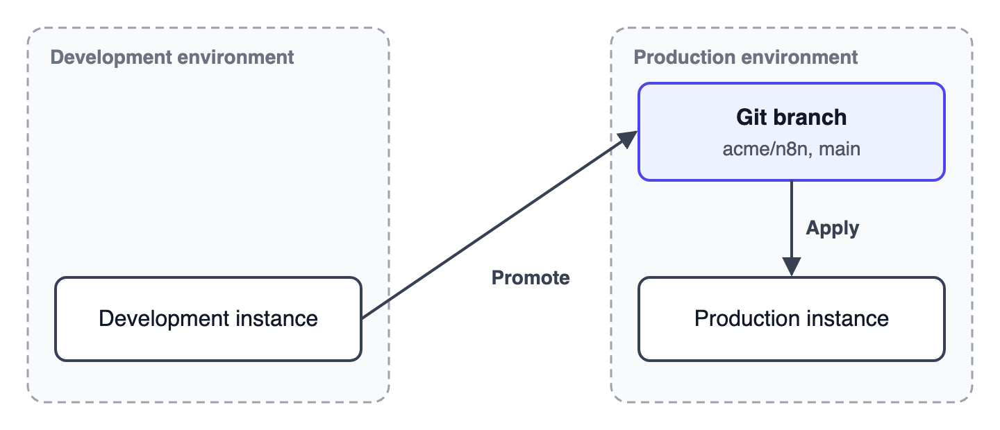
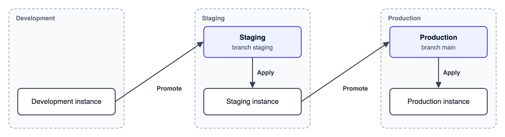

# Plan your environments

Decide which instances promote changes, which instances apply them, and which repository and branch stand for each environment before you set anything up.


**Preview status**

Environments are in Preview and may change in future releases. Try them on test instances before you set them up for your production instances.


## How instances and environments relate

You configure the environments of each instance on their own. Each instance can have two, one per direction:

- The environment the instance promotes changes to.
- The environment the instance applies changes from.

With [Git-based promotion](git-based-promotion/), each environment has its own provider, repository, and branch, and none of these have to match across directions or instances. An instance can apply from one repository and promote to another, or use different branches of the same repository. Changes reach the next instance once they're on the branch it applies from, whether n8n commits them there directly or someone merges them in.

Name each environment after the stage it stands for, such as Staging or Production. The patterns below are common setups, not the only ones.

## Development and production

Use this pattern when one team builds on one instance and runs workflows on another.

| Instance | Promote changes to | Apply changes from |
|---|---|---|
| Development | Production: repository `acme/n8n`, branch `main` | None |
| Production | None | Production: repository `acme/n8n`, branch `main` |

## Development, staging, and production

Use this pattern when you test changes on a staging instance before they reach production. The staging instance has two environments: it applies changes from Staging and promotes changes to Production.

| Instance | Promote changes to | Apply changes from |
|---|---|---|
| Development | Staging: branch `staging` | None |
| Staging | Production: branch `main` | Staging: branch `staging` |
| Production | None | Production: branch `main` |

Staging and Production can be two branches in one repository, as in the table, or branches in two repositories. Use two repositories if different teams own staging and production, or if they need different access rules on your Git host.

## Review changes before production

To make sure production only applies changes someone reviewed, set the environment that promotes to Production to push each promote to a feature branch. n8n then never commits directly to the branch production applies from:

- With GitLab, n8n also opens a merge request, which you approve in n8n as a [promotion review](promotion-reviews.md).
- With Generic Git, someone merges the feature branch on the Git host.

## Set up a new target instance

To bring projects to a new target instance, apply them one by one with a project apply, or run one [instance apply](apply-changes.md#instance-apply) to bring over every project at once. An instance apply overwrites everything on the instance, so run it before people work there.

## Protect the instances that only apply

Turn on **Protected instance** on instances that only apply changes, such as production. This stops people from editing workflows or creating resources there in the UI, so the instance stays in line with its environment. See [Set up environments](set-up-environments.md#protect-an-instance).

## Related resources

- [Environments](./)
- [Set up environments](set-up-environments.md)
- [Promote changes](promote-changes.md)
- [Apply changes](apply-changes.md)
- [Promotion reviews](promotion-reviews.md)
- [Git-based promotion](git-based-promotion/README.md)
- [Known limitations](known-limitations.md)
- [Switch from Environments (Classic)](switch-from-environments-classic.md)
