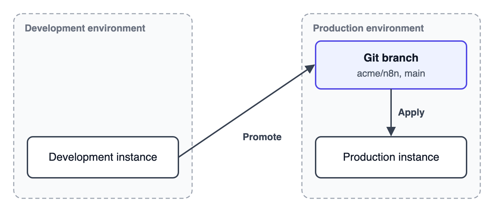
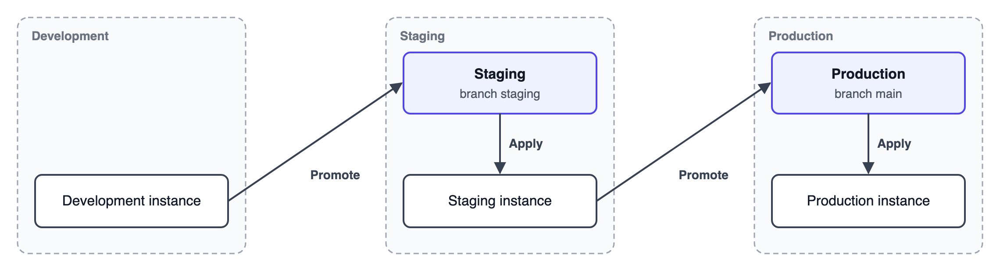

# Plan your environments

Decide which instances promote changes, which instances apply them, and which repository and branch stand for each environment before you set anything up.


**Preview status**

Environments are in Preview and may change in future releases. Try them on test instances before you set them up for your production instances.


## How instances and environments relate

Each instance belongs to one environment and promotes to the next. You configure this on each instance separately in **Settings** > **Environments**, with up to two environment configurations:

- **Apply:** the environment the instance belongs to. The instance applies changes from it.
- **Promote:** the next environment. The instance promotes changes to it.

With [Git-based promotion](git-based-promotion/README.md), each environment configuration uses a provider, repository, and branch. They don't have to match across directions or instances, and several configurations can share a provider. An instance can apply from one repository and promote to another, or use different branches of the same repository. Changes reach the next instance once they're on the branch it applies from, whether n8n commits them there directly or someone merges them in. To approve changes before they reach the branch, use [promotion reviews](promotion-reviews.md).

Name each environment after its step in your release process, such as Staging or Production. The patterns below are common setups, not the only ones.

## Development and production

Use this pattern when one team builds on one instance and runs workflows on another.

| Instance | Promote changes to | Apply changes from |
|---|---|---|
| Development | Production: repository `acme/n8n`, branch `main` | None |
| Production | None | Production: repository `acme/n8n`, branch `main` |

On the development instance, add a Production promote environment configuration. On the production instance, add a Production apply environment configuration, pointing to the same repository and branch.

## Development, staging, and production

Use this pattern when you test changes on a staging instance before they reach production. The staging instance has two environments: it applies changes from Staging and promotes changes to Production.

| Instance | Promote changes to | Apply changes from |
|---|---|---|
| Development | Staging: branch `staging` | None |
| Staging | Production: branch `main` | Staging: branch `staging` |
| Production | None | Production: branch `main` |

On the development instance, add a Staging promote environment configuration. On the staging instance, add a Staging apply and a Production promote environment configuration. On the production instance, add a Production apply environment configuration. The configurations for the same environment point to the same repository and branch.

Staging and Production can be two branches in one repository, as in the table, or branches in two repositories. Use two repositories if different teams own staging and production, or if they need different access rules on your Git host.

## Set up a new target instance

To bring your work to a new target instance for the first time, follow [Your first promotion](first-promotion.md). If your instances use Environments (Classic), follow [Migrate from Environments (Classic)](upgrade-from-environments-classic.md#migrate-from-environments-classic).

## Protect the instances that only apply

Turn on **Protected instance** on instances that only apply changes, such as production. See [Protect a production instance](protect-a-production-instance.md).

## Related resources

- [Environments](./)
- [Your first promotion](first-promotion.md)
- [Protect a production instance](protect-a-production-instance.md)
- [Promote changes](promote-changes.md)
- [Apply changes](apply-changes.md)
- [Promotion reviews](promotion-reviews.md)
- [Git-based promotion](git-based-promotion/README.md)
- [Known limitations](known-limitations.md)
- [Upgrade from Environments (Classic)](upgrade-from-environments-classic.md)
