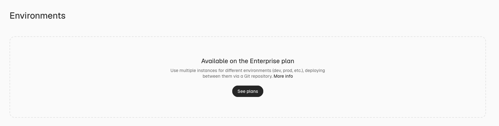
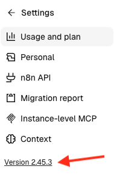

# Understand feature availability

Whether you have access to an n8n feature depends on your **plan**, **platform**, and **n8n version**.
To what extent you can rely on it depends on its maturity status (**Preview**, **GA**, **deprecated**, or **removed**) and, for Enterprise setups, whether it is **Enterprise ready** or has **Limited enterprise readiness**.

This page explains:

* How platform and plan limits apply
* What each maturity status means, and where it sits in a feature's lifecycle
* What Limited enterprise readiness means, and how it differs from Preview
* How Preview and Limited enterprise readiness relate to Beta Features in your agreement
* How n8n versioning works

Each of these has its own label or hint in n8n docs, for example a **Feature availability** hint, a **Preview status** hint, or a **Limited enterprise readiness** hint, so you'll recognize the same information wherever a page states it.

## Feature availability by platform

n8n offers two primary deployment options:

- **n8n Cloud**: a managed setup on an instance run by n8n.
- **Self-hosted**: run n8n on your own machine or infrastructure, or on your cloud platform of choice.

Most features are available on both platforms. Only a few exist on one platform or the other. For example, the [AI Transform](https://app.gitbook.com/s/BKcbOzIWja8NfqKDcqHc/builtin/core-nodes/n8n-nodes-base.aitransform) node is only available on n8n Cloud, while [LangSmith tracing](https://app.gitbook.com/s/rPN1zU5jaYNvwH7RzxqA/integrate-ai/langchain-in-n8n#use-langsmith-with-a-self-hosted-n8n-instance) is only available on self-hosted.

### Platform limits in the docs

Docs assume a feature works on both platforms. If it doesn't, the feature's page carries a platform-specific **Feature availability** hint, for example:


**Feature availability**

**AI Transform** is available on:

- **n8n Cloud:** All plans

It isn't available on self-hosted n8n.


### Platform limits in the product

A feature that's not available on your platform doesn't usually appear in your n8n interface at all, rather than showing up locked.

## Feature availability by plan

Plan or edition is your [commercial tier](https://n8n.io/pricing/):

- For n8n Cloud: **Starter**, **Pro**, or **Enterprise**.
- For self-hosted: **Community**, **Registered Community**, **Business**, or **Enterprise**.

For example, [log streaming](observe-and-log/stream-logs-to-external-systems.md) is only available on Enterprise. The number of [shared projects](manage-users-and-access/set-permissions-and-roles-rbac/organize-work-in-projects.md) you can have differs according to your plan.

### Plan limits in the docs

Docs assume a feature is available on every plan and edition. If it isn't, the feature's page carries a plan-specific **Feature availability** hint that lists the plan or edition required on each platform. Where a platform includes the feature in every plan or edition, the hint says so.


**Feature availability**

Credential sharing is available on:

- **n8n Cloud:** All plans
- **Self-hosted:** Business, Enterprise


For the full breakdown of what each self-hosted edition includes, see [Compare plans and editions](https://app.gitbook.com/s/jm0ZYRpZIPWge2ZSiDYO/host-n8n/community-edition-features). For the current feature list per plan, the [pricing page](https://n8n.io/pricing/) is the source of truth, since plan contents can change.

### Plan limits in the product

A feature that needs a higher plan or edition still shows up in the n8n interface, but is blocked, with a note about the required plan to access it.

## Feature maturity: Preview, GA, deprecated, and removed

Every n8n feature has a maturity status:

* **Preview**: n8n might still make breaking changes to the feature, such as changing an API shape, export format, node parameters, or execution outcomes, or remove it entirely. Avoid relying on Preview features in a production workflow. Preview isn't for bugs, missing options, unfinished UI, or newness: a GA feature can have those too.
* **Generally available (GA)**: Not a label n8n shows, but the default where no other label is given. A GA feature is stable and production ready, and n8n only makes breaking changes to it through the deprecation process.
* **Deprecated**: The feature still works, but n8n plans to remove it and recommends moving away from it.
* **Removed**: The feature no longer exists in the current version. Removal always happens at a major version.

For nodes specifically, check [Deprecated and versioned nodes](https://app.gitbook.com/s/BKcbOzIWja8NfqKDcqHc/builtin/deprecated-nodes) for the current, automatically updated list.

### Maturity status in the docs

Docs mark each status differently:

* **Preview**: when a whole page covers a Preview feature, a **Preview** tag appears in the page header. The page or section also carries a **Preview status** hint, for example:

    
    **Preview status**

    OpenTelemetry tracing is in Preview from n8n 2.19.0 and may change in future releases. Avoid relying on it in production workflows.
    

* **GA**: no marker, since it's the default.
* **Deprecated**: when a whole page covers a deprecated feature, a **Deprecated** tag appears in the page header and in the navigation menu. A note on the page, setting, or node names the version it was deprecated from and its replacement, where one exists.
* **Removed**: the version's breaking changes page, for example [n8n 3.0 breaking changes](https://app.gitbook.com/s/hhM8Cox90Piiv0u0EgHM/v30-breaking-changes), records the removal and what to do instead. The feature's own page may no longer exist.

### Maturity status in the product

Preview and Deprecated show as a label in the n8n interface. Preview labels appear where you encounter the feature, such as its page header, node, or panel, and next to its toggle in settings. They don't appear in the main navigation, such as the sidebar. Deprecated labels appear next to a node in the node panel and in its settings. A feature or node with no label is GA.

A removed feature doesn't appear in the interface. If a workflow relied on it, check the breaking changes page for the version you updated to.

## Enterprise readiness

Separately from maturity, a feature can have **Limited enterprise readiness**. This status concerns [Enterprise plan](https://app.gitbook.com/s/CxSeOtVxqqhfxMSac0AV/choose-how-to-use-n8n#decision-2-choose-a-plan-or-edition) admins. It tells them that some Enterprise capabilities don't cover the feature yet. See [Enterprise capabilities](#enterprise-capabilities) for the full list.

There are two states:

* **Enterprise ready**: every Enterprise requirement that applies to the feature is met.
* **Limited enterprise readiness**: at least one applicable Enterprise requirement isn't met yet.

### How Preview and Limited enterprise readiness differ

The two statuses are independent. A feature can be GA and have Limited enterprise readiness, or be in Preview and fully Enterprise ready, although that combination is rare.

| | Preview | Limited enterprise readiness |
|---|---|---|
| **Question it answers** | Might n8n make breaking changes to this feature, or remove it? | Do all the Enterprise capabilities that apply to this feature work with it? |
| **Who sees it** | Everyone | Enterprise admins |
| **What a gap means** | n8n doesn't commit to stability or compatibility. | The feature doesn't yet work with part of your Enterprise setup. |
| **Where it appears** | The feature's own surface, its settings entry, docs, and API reference | Next to the admin toggle and in docs |
| **When it's removed** | When n8n no longer plans breaking changes or removal | When every applicable Enterprise requirement is met |

A gap in Enterprise readiness doesn't make a feature Preview. For example, a feature without queue mode and multi-main support isn't in Preview, and users who don't run those modes aren't affected.

### Enterprise capabilities

This is the full list of Enterprise capabilities. n8n assesses each feature against the ones that apply to it:

- **SSO**
- **RBAC and project scoping**
- **Data residency**
- **Queue mode and multi-main**
- **Environments and source control**
- **Audit events and log streaming**
- **OpenTelemetry tracing**
- **External secrets**
- **Public API**
- **Enterprise-scale volumes**
- **Policy coverage for new nodes, credentials, and resources**

### Enterprise readiness in the docs

Docs show nothing for an Enterprise ready feature, so a feature with no label is Enterprise ready.

If a feature has Limited enterprise readiness, its page carries a **Limited enterprise readiness** hint. The hint names the feature and lists the Enterprise capabilities it supports, with its level of readiness right now: **Full** or **Partial**. It then says the other Enterprise capabilities either don't apply to the feature or it doesn't support them yet, and links to the full list.


**Limited enterprise readiness**

The Example feature has Limited enterprise readiness. It supports the following Enterprise capabilities:

- **SSO:** Full
- **External secrets:** Partial

Other Enterprise capabilities either don't apply to the Example feature or it doesn't support them yet. See [Understand feature availability](#enterprise-capabilities) for the full list of Enterprise capabilities.


A feature that isn't available on Enterprise at all doesn't carry this label. That's a plan or platform limit, see [Feature availability by plan](#feature-availability-by-plan).

### Enterprise readiness in the product

The n8n interface likewise shows nothing for an Enterprise ready feature. A feature with Limited enterprise readiness carries a **Limited enterprise readiness** label in the n8n interface, wherever you encounter its toggle. On Enterprise plans, a feature that's in Preview or has Limited enterprise readiness should be off by default. Admins turn it on from the settings page, or with an environment variable on self-hosted instances. The Preview and Limited enterprise readiness labels appear next to the toggle, so you can make an informed choice before you enable the feature.

## How Preview and Limited enterprise readiness relate to Beta Features in your agreement

Your agreement with n8n refers to "Beta Features". A feature labeled Preview or Limited enterprise readiness is a Beta Feature. n8n provides it as is, and you use it at your own risk until n8n removes the label. Until then, n8n may change or discontinue it at any time. n8n may also start charging for it after the label is removed.

"Beta Features" are separate from the Beta release track on n8n Cloud, which only controls when your workspace receives new releases. See [Feature availability by n8n version](#feature-availability-by-n8n-version).

## Feature availability by n8n version

n8n has two types of version number:

* **Instance version**: the n8n release itself, written as three-part [semantic versioning](https://semver.org/), for example n8n 2.30.0. The MAJOR number increments for incompatible changes that can need user action, MINOR for backward-compatible new features, and PATCH for backward-compatible fixes. Environment variables, APIs, CLI commands, and hooks are all tied to this version.
* **Node version**: a single node's own version number, usually two parts, for example node version 4.7. A node can gain a new version independently of the n8n release it ships in.

n8n Cloud workspaces choose a release track and an update cadence, rather than a single fixed version you upgrade by hand. The two settings are:

* **Release track**: **Beta** delivers new releases as soon as they're ready. **Stable** runs a later, more proven patch that's already spent time on Beta. n8n recommends Stable for mission-critical workloads.
* **Update cadence**: **Security & stability** upgrades roughly every two weeks. **Every new release** upgrades on every release, on average about once a day. Security and stability fixes apply automatically either way.

Switch tracks or cadence anytime from **Updates & maintenance** in your workspace settings, see [Update your version](https://app.gitbook.com/s/jm0ZYRpZIPWge2ZSiDYO/use-n8n-cloud/update-your-version). Self-hosted instances update on your own schedule instead, see [Update n8n](https://app.gitbook.com/s/jm0ZYRpZIPWge2ZSiDYO/host-n8n/keep-n8n-running/update-n8n).

### Version availability in the docs

Individual doc pages don't systematically record the version a feature arrived in. For many newer features, the page carries a version-based **Feature availability** hint, for example:


**Feature availability**

Canvas Groups are available from n8n 2.28.0.


Older features and smaller changes often have no such hint, so a missing hint doesn't mean a feature exists in every version.

To find out what's available in a given version, use whichever of these matches how much detail you need:

* [Changelog](https://app.gitbook.com/s/hhM8Cox90Piiv0u0EgHM/): a curated, narrative summary of the most important features as n8n rolls them out.
* [Release notes](https://app.gitbook.com/s/hhM8Cox90Piiv0u0EgHM/release-notes): every feature-level update, one line per feature, newest first, also available as an RSS feed.
* [GitHub releases](https://github.com/n8n-io/n8n/releases): full change detail linked to commits, including bug fixes and minor changes the other two skip.

### Version availability in the product

Your instance version appears at the bottom of the **Settings** sidebar. On n8n Cloud, **Updates & maintenance** also shows the version your workspace runs.

A feature that was added in a later version than yours doesn't appear in your n8n interface until you update.

Publishing in the changelog or release notes doesn't guarantee a feature has reached your instance yet. Some features ship behind a flag you need to enable, and others roll out gradually to n8n Cloud or self-hosted instances before reaching everyone.

## Other factors influencing feature availability

* **Role or permissions**: even when your plan, platform, and version all include a feature, your instance owner or admin decides whether your role can see or use it.

This is a limit your own admin sets, not n8n. See [Understand instance roles](manage-users-and-access/understand-instance-roles.md) and [Set permissions and roles (RBAC)](manage-users-and-access/set-permissions-and-roles-rbac/README.md) for how roles and permissions work.

## Related resources

* [Administer](./)
* [Manage users and access](manage-users-and-access/README.md)
* [Use source control and environments](use-source-control-and-environments/README.md)
* [Manage credentials](manage-credentials/README.md)
* [Observe and log](observe-and-log/README.md)
