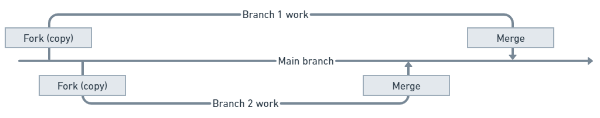

# Git concepts for environments

Both versions of n8n environments use Git to move work between n8n instances. Git provides the source control for environments: it stores your work outside your n8n instance and lets you send it to and from your instances. For what source control means in n8n, see [Use source control and environments](README.md#what-source-control-means). To use environments, it helps to know some basic Git concepts. n8n doesn't implement all Git functionality: don't treat environments as full version control.


**New to Git?**

If you're new to Git, don't panic. You don't need to learn Git to use n8n. This page explains the concepts you need. You do need some Git knowledge to set up environments, as this involves work in your Git provider.


This page introduces the Git concepts and terminology used in n8n. It doesn't cover everything you need to set up and manage a repository. The person setting up environments should have some familiarity with Git and with their Git hosting provider.


**This is a brief introduction**

Git is a complex topic. This page provides a brief introduction to the key terms you need when using environments in n8n. If you want to learn about Git in depth, refer to [GitHub | Git and GitHub learning resources](https://docs.github.com/en/get-started/quickstart/git-and-github-learning-resources).


## Git overview

[Git](https://git-scm.com/) is a source control tool for managing, tracking, and collaborating on multiple versions of documents. It's the basis for widely used platforms such as [GitHub](https://github.com/) and [GitLab](https://about.gitlab.com/).

## Branches: Multiple copies of a project

Git uses branches to maintain multiple copies of a document alongside each other. Every branch has its own version. A common pattern is to have a main branch, and then everyone who wants to contribute to the project works on their own branch (copy). When they finish their work, their branch is merged back into the main branch.

## Local and remote: Moving work between your machine and a Git provider

A common pattern when using Git is to install Git on your own computer, and use a Git provider such as GitHub to work with Git in the cloud. In effect, you have a Git repository (project) on GitHub, and work with copies of it on your local machine.

n8n uses this pattern for environments: you work with your workflows on your n8n instance, but send them to your Git provider to store them.

## Pull requests and merge requests

A pull request or merge request proposes merging one branch into another, so that other people can review the changes first. GitHub calls this a pull request. GitLab calls it a merge request.

## How Environments (Classic) and Environments (Preview) use Git

The two versions use different terms for moving work to and from Git, and they differ in how review fits in:

| | Environments (Classic) | Environments (Preview) |
|---|---|---|
| Moving work | You push work from an instance to Git and pull it from Git into an instance. Commit and push happen at the same time. | You promote changes from an instance to an environment's branch, and an instance applies changes from an environment's branch. |
| Branches | You link an instance to a branch. | Each environment points to a repository and a branch. |
| Review | n8n doesn't support a pull request-style review and merge process. You can do this outside n8n, in your Git provider. | With GitLab, promotion reviews use merge requests that n8n opens and syncs, with a visual diff in n8n. With Generic Git, someone merges manually on the Git host. |

### Feature branches in Environments (Preview)

An environment can commit promoted changes directly to its branch. Or it can push each promote to a feature branch named `n8n-promotion/<timestamp>`, based on its branch. Instances that apply from the environment read its branch, so they see changes from a feature branch only after someone merges it. n8n never force-pushes.

See [Git-based promotion](preview/git-based-promotion/README.md) for how Environments (Preview) use repositories, branches, and Git providers. See [Use Git in n8n](classic/use-git-in-n8n.md) for how Environments (Classic) push, pull, and commit.

## Related resources

- [Use source control and environments](README.md)
- [Environments (Classic)](classic/README.md)
- [Environments (Preview)](preview/README.md)
