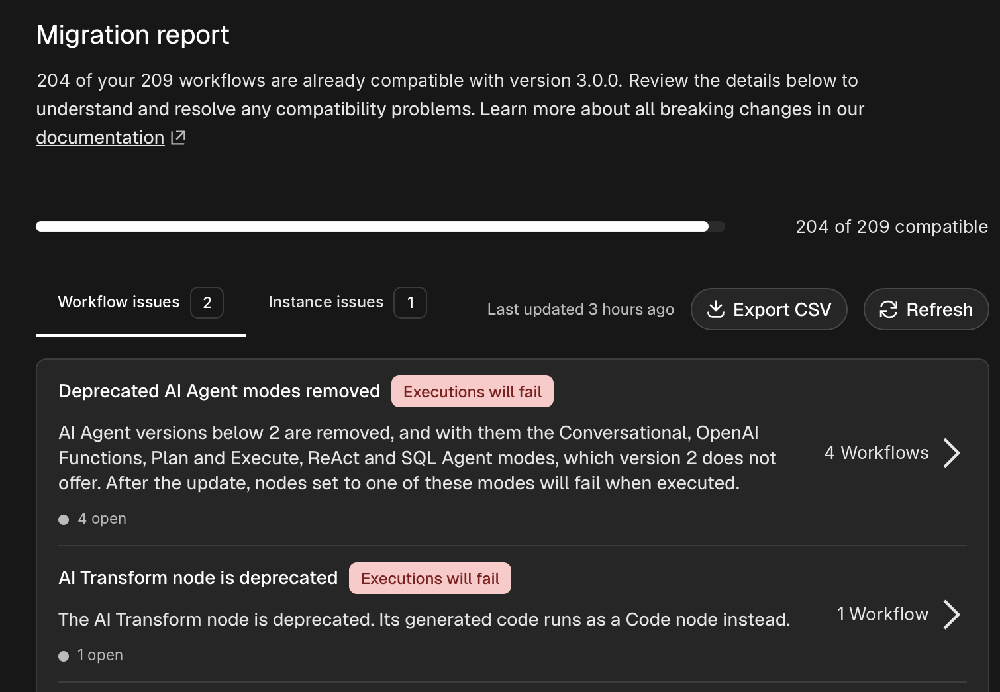
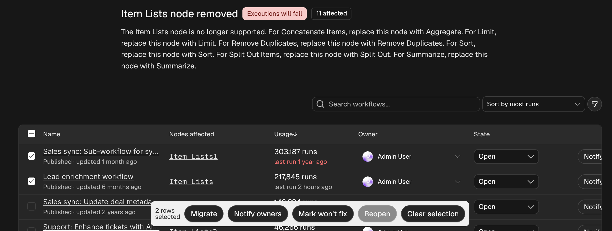

# n8n 3.0 migration tool

The migration tool scans your n8n instance and lists the workflows and instance settings that n8n 3.0 changes, so you can fix them before you upgrade. You open it in the editor as the migration report, at **Settings > Migration Report**.

For the full list of changes, refer to [v3.0 breaking changes](v30-breaking-changes.md).

## Who can use the migration report

All users can open the migration report, but what they see depends on their permissions.

| | Instance owner and admins | Other users |
|---|---|---|
| See workflow issues | For every workflow on the instance | For workflows they can edit |
| See the **Instance issues** tab | Yes | No, the tab isn't shown |
| Refresh the report | Yes | No |
| Notify workflow owners | Yes, if you set up email (SMTP) | No |

Other users see a note at the top of the page: "This report only includes the workflows you can edit."

## Read the compatibility summary

At the top of the page, a progress bar shows how many of your workflows are compatible with n8n 3.0. A compatible workflow keeps working after the upgrade without changes. Your goal is to resolve the issues that stop the remaining workflows from being compatible, and the instance issues.

n8n re-checks a workflow when you save it, so the report stays current as you fix issues. **Last updated** shows when n8n last ran a full scan. To run a full scan yourself, select **Refresh**.

The tool organizes issues into two tabs.

### Workflow issues

The **Workflow issues** tab lists the changes that affect workflows on your instance. Each issue shows:

- **Title and description:** What changes and why it matters.
- **Impact badge:** How the change affects your workflows. Hover over the badge for details. Refer to [Impact levels](#impact-levels).
- **Workflow count:** How many workflows have the issue. Select it to open the issue's detail page.
- **Open count:** How many of those workflows still need a fix. A count of workflows marked won't fix appears next to it when there are any.
- **Documentation:** A link to the matching section of [v3.0 breaking changes](v30-breaking-changes.md).

### Instance issues

The **Instance issues** tab lists configuration changes that affect the whole instance, for example environment variables and deployment settings. Instance issues have a title, description, impact badge, and documentation link, but no workflow count, because they apply to the whole instance. Only instance owners and admins see this tab.

### Impact levels

Each issue has one of five impact levels.

| Impact | Meaning |
|---|---|
| **Upgrade blocked** | The upgrade can't proceed, or the instance may not start after it. Fix this first. |
| **Executions will fail** | Affected workflows or the instance fail after the upgrade. Update or replace the affected nodes or settings. |
| **Executions might fail** | A default changes, so executions might fail. Read the recommendation to keep the current value. |
| **Behavior changes** | Affected workflows keep running, but they behave differently. Review and test them before you upgrade. |
| **Capability removed** | Executions aren't affected, but a feature your workflows or instance use is no longer available. |

## Work through a workflow issue

Select the workflow count on an issue to open its detail page. The page lists every affected workflow with:

- **Name:** Select it to open the workflow in the editor.
- **Owner:** The person responsible for the fix. Refer to [Assign an owner](#assign-an-owner).
- **Nodes affected:** The nodes with the issue. Select a node to open the workflow with that node in view.
- **State:** Whether the finding is **Open**, **Notified**, or **Won't fix**.
- **Published:** Whether the workflow is live, and the date of its last update.
- **Usage:** The number of executions and the date of the last run.

To act on several workflows at once, select the checkbox next to each one. A bulk action bar appears with **Migrate**, **Notify owners**, **Mark won't fix**, **Reopen**, and **Clear selection**. Some actions only appear when they apply, for example **Migrate** for issues that n8n can migrate automatically.

### Find the workflows to fix first

To narrow the list, use the search box, the sort menu, and the quick filters (**Assigned to me**, **Open**, **Won't fix**, **Unassigned**). Select **Filters** to filter by:

- State
- Last run
- Last updated
- Number of executions
- Status (published or not)
- Owner
- Project

Sort by most runs to fix your busiest workflows first. If a workflow hasn't run in over 12 months, a banner offers to mark it as won't fix, so it stays out of the way.

### Migrate workflows automatically

For some issues, n8n can rewrite the affected nodes for you. When an issue supports this, a **Migrate** button appears on each row. For example, n8n can replace a Cron node with a Schedule Trigger node.

To migrate a workflow:

1. Select **Migrate**, or select several workflows and select **Migrate** in the bulk action bar.
1. Review the list of nodes n8n changes, then confirm.
1. n8n saves the result as a new version of the workflow. A published workflow keeps running its current version until you publish the new one.
1. Select **Publish** to make the migrated version live, or **Skip publishing** to review it first.

Test migrated workflows before you publish them. The automatic migration covers the node changes only, so check the workflow's output still matches what you expect.

### Assign an owner

Each workflow can have an owner, the person who's responsible for fixing it. n8n suggests the last user who worked on the workflow, or an owner of the workflow's project if no single user stands out. To change it, select the owner in the **Owner** column and pick another user.

### Notify owners

Instance owners and admins can email workflow owners about an issue. Select **Notify owner** on a row, or select several workflows and select **Notify owners**. The workflow's state changes to **Notified**. To send the email again, select **Remind**.

Notifications need email (SMTP) set up on your instance and an owner with an email address on the workflow. A notification doesn't resolve the issue. The workflow still counts as unresolved until you fix it or mark it as won't fix.

### Mark a workflow as won't fix

If you don't plan to fix a workflow, for example because it's obsolete, set its state to **Won't fix**. It then counts as resolved and no longer shows as open. Select **Reopen** to undo this. If you later fix the issue, n8n removes it from the report.

## Export the report

Select **Export CSV** to download the overview as a CSV file. Use it to share your migration progress, for example with n8n support. The export includes the same workflows and issues you see in the report.

The file has one row for each issue. The instance totals repeat on every row, so the file opens in a spreadsheet as is. The columns are:

| Column | Description |
|---|---|
| `target_version` | The n8n version the report checks against. |
| `current_version` | The n8n version your instance runs. |
| `synced_at` | When n8n last ran a full scan. |
| `total_workflows` | The number of workflows in the report. |
| `affected_workflows` | The number of workflows with at least one unresolved issue. |
| `affected_instance_rules` | The number of instance issues. |
| `rule_kind` | Whether the row is a workflow issue or an instance issue. |
| `rule_id` | The issue's ID. |
| `rule_title` | The issue's title. |
| `impact` | The impact level as an identifier, for example `executionsFail`. |
| `impact_label` | The impact level as shown in the report, for example "Executions will fail". |
| `unresolved_workflows` | The number of workflows where the issue is open or notified. |
| `wont_fix_workflows` | The number of workflows marked as won't fix. |

## What an empty report means

| Tab | Empty means |
|---|---|
| **Workflow issues** | All your workflows are compatible with n8n 3.0. Check **Instance issues** next. |
| **Instance issues** | Your instance configuration is ready for n8n 3.0. Check **Workflow issues** next. |
| Both | The tool found nothing to fix. Review [v3.0 breaking changes](v30-breaking-changes.md) for changes the tool can't detect, then upgrade. |

## Recommended workflow

1. **Assess.** Check the compatibility summary, then browse both tabs to see how much work there is.
1. **Start with the highest impact.** Fix **Upgrade blocked** and **Executions will fail** issues first, then **Executions might fail**, **Behavior changes**, and **Capability removed**.
1. **Fix workflow issues.** Open each issue, migrate or edit the affected workflows, and test them in a development environment.
1. **Fix instance issues.** Update environment variables and server configuration as each issue describes.
1. **Verify.** Instance owners and admins select **Refresh** to run a full scan. Other users reload the report, which reflects the workflows they saved. Confirm that no unresolved issues remain and that the compatibility count matches the total workflow count in the report.
1. **Upgrade.** Upgrade to n8n 3.0.

## Related resources

- [Changelog](./)
- [v3.0 breaking changes](v30-breaking-changes.md)
- [v2.0 migration tool](v20-migration-tool.md)
- [v2.0 breaking changes](v20-breaking-changes.md)
- [v1.0 migration guide](v10-migration-guide.md)
